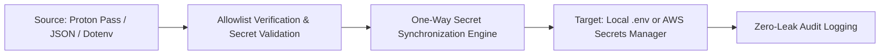

<p align="center"><a href="https://kitsunetechnologies.org/work"></a></p>

# Secret Bridge

One-way secret synchronization from JSON, dotenv, or Proton Pass to .env or AWS Secrets Manager.

[](https://github.com/KitsuneTech1/secret-sync/actions)
[](LICENSE) [](#requirements)

Secret Bridge copies an allowlisted set of secret values in one direction. It
can read local JSON or dotenv files, or run under `secret-run` to receive
selected Proton Pass items. It writes either a dotenv file or one AWS Secrets
Manager secret. `--dry-run` shows what would be written without making changes.

There are no bidirectional writes.

## Requirements

- Python 3.8 or newer
- `secret-run` on `PATH` (for Proton Pass input only)
- AWS CLI on `PATH` (for AWS Secrets Manager destination only)

Local file mode uses only the Python standard library, so no packages need installing for that.


## Architecture & Data Flow



## Quick start

Create a config file with the secrets to copy and where they go:

**For dotenv output:**
```json
{
  "secrets": ["API_KEY", "DB_PASSWORD"],
  "destination": ".env.local"
}
```

**For AWS Secrets Manager:**
```json
{
  "secrets": ["API_KEY", "DB_PASSWORD"],
  "destination": {
    "type": "aws-secrets-manager",
    "name": "my-app/config",
    "region": "us-east-1"
  }
}
```

Then sync from a local file or Proton Pass:

```bash
# From JSON source
python sync.py config.json --source secrets.json

# From dotenv source
python sync.py config.json --source .env.production

# From Proton Pass (via secret-run)
python sync.py config.json --role production

# Dry-run any of the above
python sync.py config.json --source secrets.json --dry-run

# Generate a stub .env file
python sync.py config.json --stub
```

## Configuration details

Secret names must be unique, non-empty environment variable names using letters, digits, and underscores, with a letter or underscore first. At least one name is required.

JSON config files may be UTF-8 with or without a byte order mark.

For dotenv destinations, the file is replaced on each run with only the selected secrets. Missing names are warned but don't fail if at least one is found.

For AWS Secrets Manager, `region` and `profile` are optional. The secret value becomes a JSON object with the selected names. Existing secrets get a new version, missing ones are created.

## How it works

**Local sources** read JSON or dotenv files directly. Only names in the allowlist are copied.

**Proton Pass input** runs under `secret-run`, which must map role names to Proton Pass items (e.g., `API_KEY = My API key`). Secret Bridge runs as a child process with those values in its environment, so they never appear in logs or command-line output.

**Dotenv output** writes a single `.env*` file with quoted values and escape sequences handled.

**AWS Secrets Manager output** writes a JSON object containing only the selected names. The payload passes through a short-lived temporary file, never appearing in CLI arguments. Existing secrets get a new version, missing ones are created.

## Source formats

JSON sources are simple objects:
```json
{
  "API_KEY": "actual-key-value",
  "DB_PASSWORD": "actual-password"
}
```

Dotenv sources support comments, `export`, quoted values, and inline comments:
```dotenv
API_KEY="actual-key-value"
DB_PASSWORD=actual-password
# UNUSED_KEY="ignored"
export SECRET="also works"
```

Only names in your allowlist are copied. Extra values in the source are ignored.

## Testing

```bash
python -m unittest
```

The suite covers 36 cases: config validation, file I/O, dotenv parsing, AWS CLI mocking, and Proton Pass integration. It uses fixtures and mocked subprocess calls, so no network or external tools are needed.

## License

MIT. Copyright (c) 2026 Kitsune Technologies LLC. Do what you like with it, commercially or otherwise, just keep the copyright notice. Full text in [LICENSE](LICENSE).

---

<p align="center"><sub>Part of <b>Buildtober 2026</b>: 31 open source projects in 31 days. Built by <a href="https://kitsunetechnologies.org/work">Kitsune Technologies</a>. More at <a href="https://github.com/KitsuneTech1">github.com/KitsuneTech1</a>.</sub></p>
